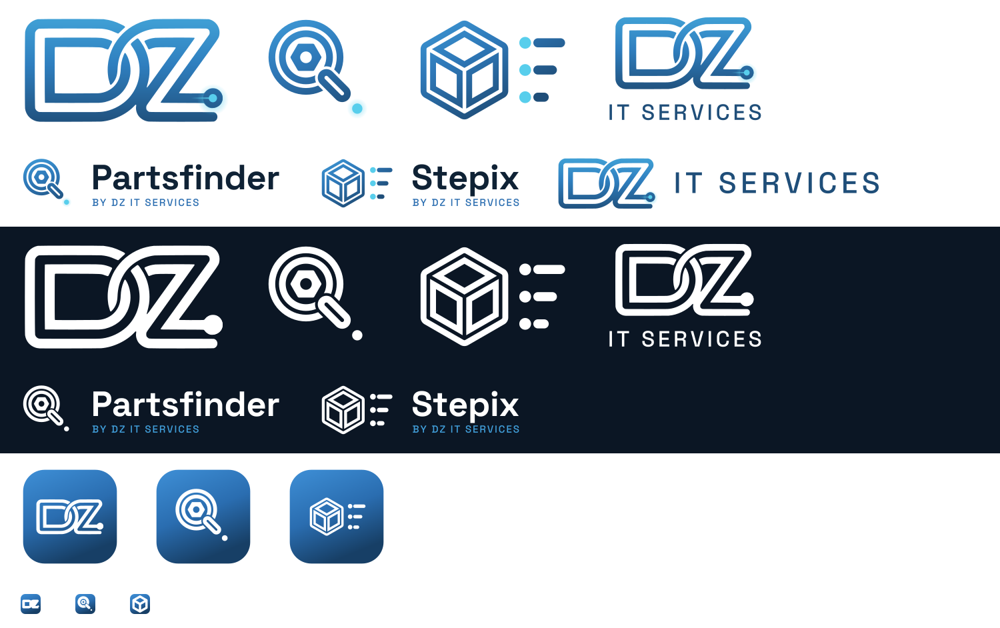

# DZ IT Services brand kit

One brand for three things: the company website (dzitservices.be) and the two apps,
**Partsfinder** and **Stepix**. This folder is identical in all three repositories.



## The idea
The DZ logo draws its letters as a *trace*: a thick blue tube with a thin white line
inside, ending in a glowing **node**. The product marks use the same tube and node,
so they read as one family.

| Mark | Meaning |
|---|---|
| DZ | The company. Interlocked D and Z, the trace ends in a node. |
| Partsfinder | A lens with a nut inside: finding the right part. The handle ends in a node. |
| Stepix | A 3D cube next to three list rows: a STEP file becomes a bill of materials. |

## Files
| Folder | What |
|---|---|
| `logos/*-mark.svg` | Marks only. `-white` for dark or coloured backgrounds, `-ink` for one-colour print. |
| `logos/*-logo.svg`, `dz-it-services-*.svg` | Mark plus name (lockups). `-white` for dark backgrounds. |
| `logos/png/` | 1200 px PNGs of the main lockups, for places that do not take SVG. |
| `icons/<name>.ico` | Windows icon (16–256 px) for the Electron apps and the installer. |
| `icons/png/<name>-<size>.png` | App icon PNGs, 16–1024 px. Sizes up to 48 px use a simplified mark without the inner line. |
| `tokens.css`, `tokens.json` | Colours, fonts, radius, shadow. CSS custom properties start with `--dz-`. |
| `fonts/` | Space Grotesk (display) and Inter (body), WOFF2, with their OFL licences. |
| `originals/` | The original raster logo files, for reference. |
| `source/trace_dz.py` | Traces the original DZ logo into `source/dz_mark_paths.json`. |
| `source/build_brand.py` | Regenerates every SVG, PNG and ICO above. |

**Status:** `logos/dz-mark.svg` is the original raster logo (`originals/`) traced into smooth
vector paths, with the node (disc, cyan dot, trace line) redrawn as exact circles and a line.
Until Drilon approves it, the original PNG stays the official DZ logo on the website.

## Using the logos
- **Clear space:** keep at least the height of the node dot (about 1/10 of the mark height) free on every side.
- **Minimum size:** marks 24 px high on screen; lockups 32 px high. Below 32 px, use the app icon instead.
- **Backgrounds:** the colour version only on white or very light surfaces (its inner lines are see-through); on dark navy, photos or the brand gradient always use the `-white` version.
- **Endorsement:** each app shows "by DZ IT Services" with a link to https://dzitservices.be in its About screen, in the footer of its website page and in its README.
- **Do not:** recolour the tube outside the brand colours, stretch, rotate, add shadows or outlines, put the colour mark on a busy photo, or rebuild a mark from another font.

## Colour
| Token | Hex | Use | Contrast on white |
|---|---|---|---|
| ink | `#0F2235` | Headings and text | 16.2 : 1 |
| deep | `#1F4E79` | Logo dark end, "IT SERVICES" | 8.7 : 1 |
| blue | `#2A6DB0` | Primary buttons and links on light | 5.4 : 1 |
| azure | `#3E86CE` | Logo, illustrations | 3.8 : 1 (not for small text) |
| sky | `#41A0DC` | Primary on dark backgrounds | 6.3 : 1 on `#0B1624` |
| teal | `#3BA6B8` | Logo, illustrations | decorative only |
| node | `#58CEEC` | Node dot, focus ring, highlights | decorative only, never text on white |

The brand gradient runs from `#41A0DC` (top) through `#2E78B8` to `#1F4E79` (bottom).
Use it for the logo, app icon tiles and large hero areas, not behind body text.

The apps support light and dark themes (dark follows the OS when the root element has
class `dz-auto-dark`); the website is light.

## Type
- **Space Grotesk** 500/700: product names, headings, buttons. Uppercase labels use 500 weight with wide letter spacing (0.12–0.14 em), like "IT SERVICES".
- **Inter** 400–700: body text, tables, forms.
- Load from `fonts/`:
  ```css
  @font-face { font-family: "Inter"; src: url("fonts/inter-latin-400-normal.woff2") format("woff2"); font-weight: 400; font-display: swap; }
  @font-face { font-family: "Space Grotesk"; src: url("fonts/space-grotesk-latin-700-normal.woff2") format("woff2"); font-weight: 700; font-display: swap; }
  ```
  The apps bundle these files so they work offline. The website loads the same families via `next/font`.

## Language
- dzitservices.be: Dutch.
- Partsfinder and Stepix (UI, docs, code, data): English.

## Licence
The DZ IT Services name, the DZ logo and the Partsfinder and Stepix names and marks are
trademarks of DZ IT Services. **All rights reserved.** They are not covered by the AGPL-3.0
licence of the source code. Forks must use their own name and logo. The fonts in `fonts/`
are under the SIL Open Font License 1.1 (see the `OFL-*.txt` files).

## Regenerate
```
pip install fonttools brotli potracer pillow numpy   # plus librsvg (rsvg-convert) and ImageMagick (convert)
python brand/source/trace_dz.py brand/source/dz_mark_paths.json   # only when the original logo changes
python brand/source/build_brand.py
```
Change shapes or colours in `build_brand.py`, never by editing the generated SVGs by hand.
